# FluentSSH Native

> GitHub 仓库：<https://github.com/lcyyun/FluentSSH>

真正原生的 Windows SSH 工作台，使用 **.NET 10 + WPF** 构建。没有浏览器内核，没有 Electron / Tauri / WebView2 外壳；终端、文件管理器、隧道和设置全部是原生桌面界面。

- 原生窗口：WPF `FluentWindow` + Mica 背景 + 系统窗口按钮
- SSH 引擎：SSH.NET（密码 / 私钥 / Keyboard-interactive）
- 终端模拟：XtermSharp 原生 WPF 控件，256 色与完整 ANSI 处理
- 本地数据：`%APPDATA%\FluentSSH`，密码与口令通过 Windows DPAPI 加密
- 可执行文件：自包含单文件 `dist\FluentSSH-native-win-x64\FluentSSH.exe`

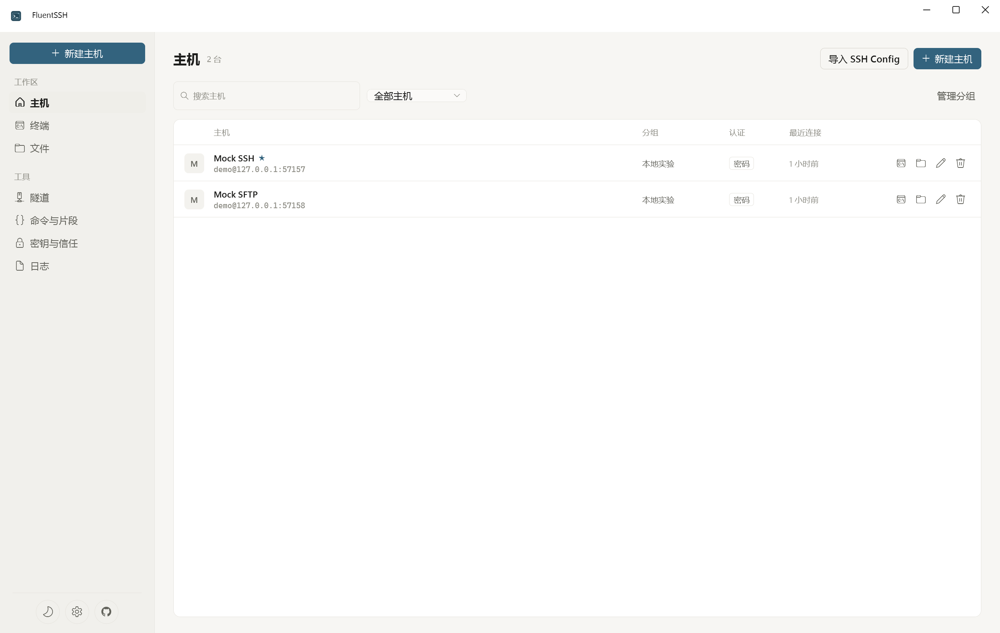
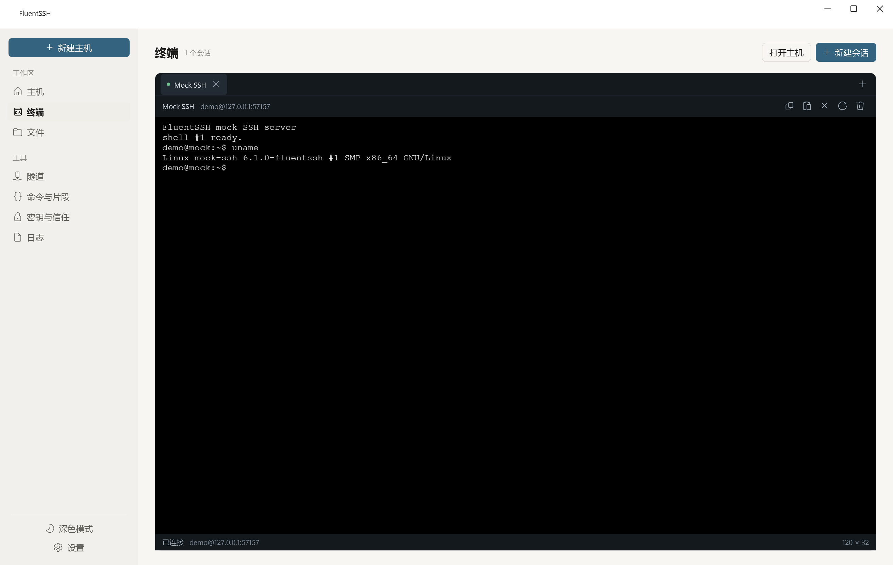
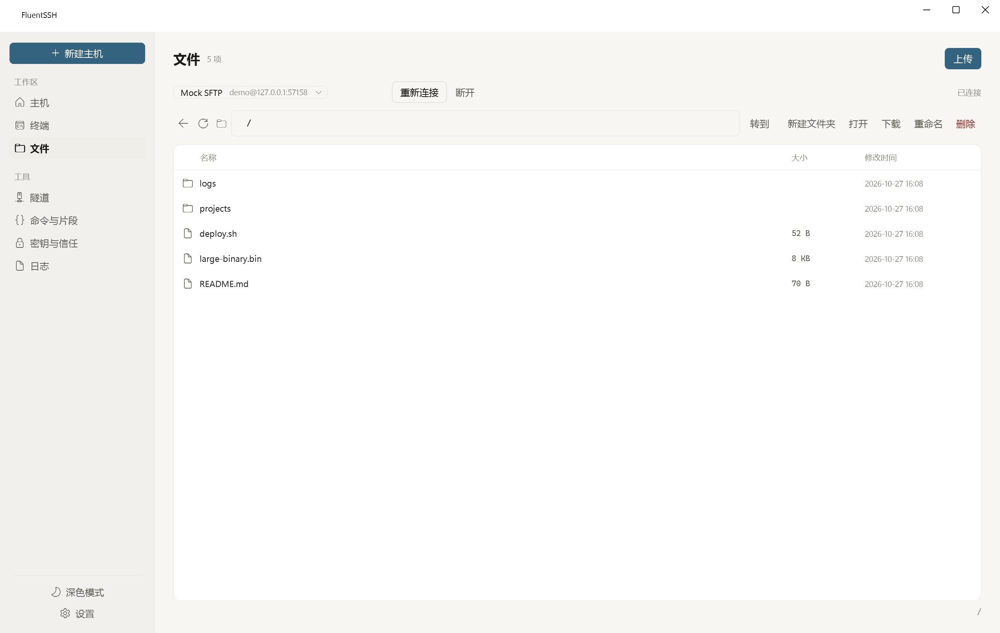
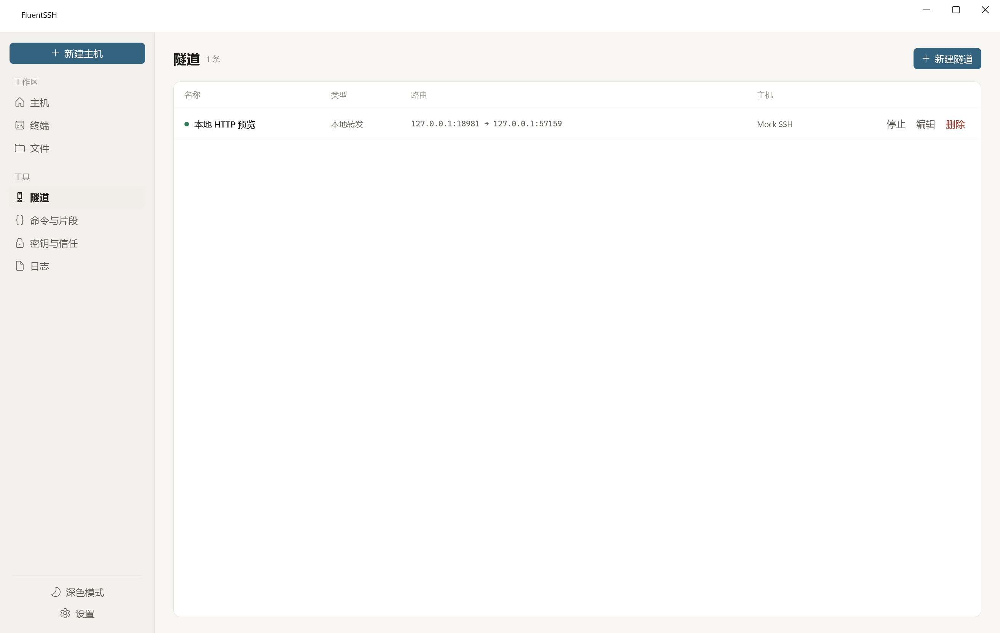
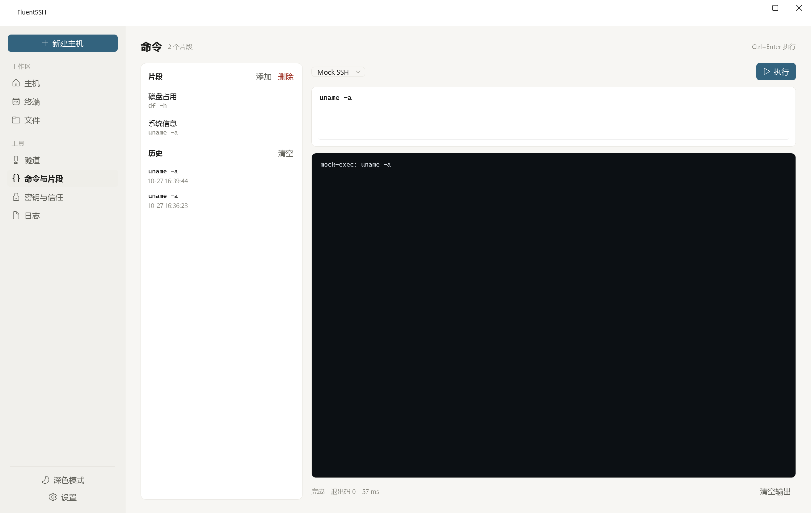
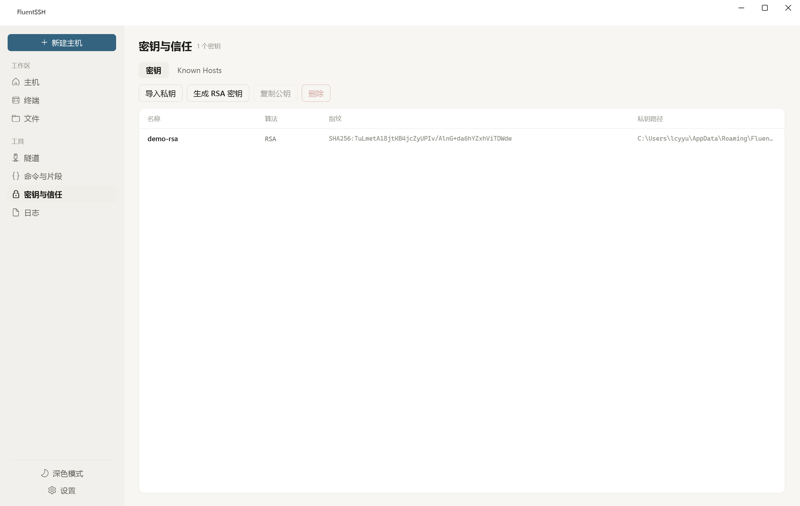
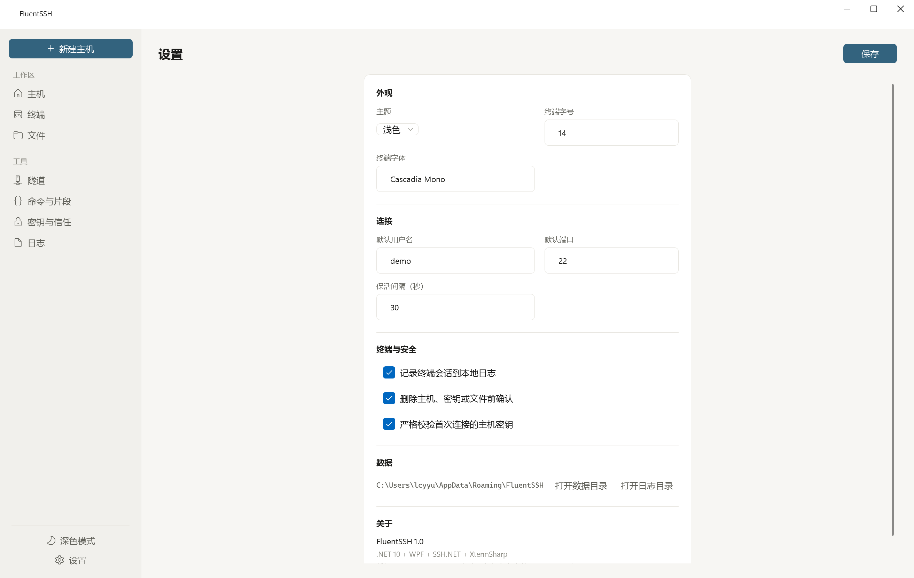
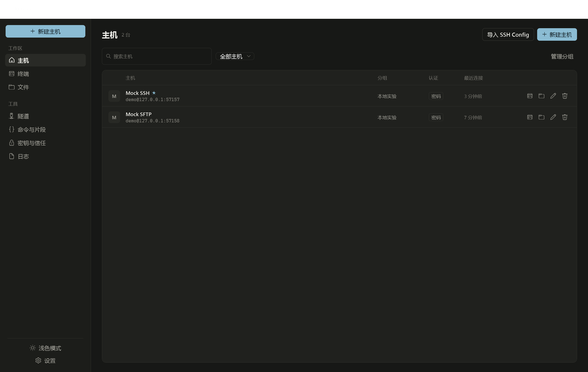

更多截图：[`docs/native/`](docs/native)

---

## Android 版本

同一仓库现在还提供**真正原生的 Android 客户端**（Kotlin + Jetpack Compose + Material 3），不依赖 WebView / Electron / 浏览器内核：

- 代码与说明：[`android/README.md`](android/README.md)
- 截图：[`android/docs/screenshots/`](android/docs/screenshots)
- 设计规范：[`mobile-design-system-skill`](https://github.com/Ludi-Herry/mobile-design-system-skill) 16 项移动端门禁逐项落地（[走查文档](android/docs/DESIGN-AUDIT.md)）
- 可选安装包：`dist/android/FluentSSH-android-v1.0.0.apk`（本地构建产物，`dist/` 默认不纳入 git）

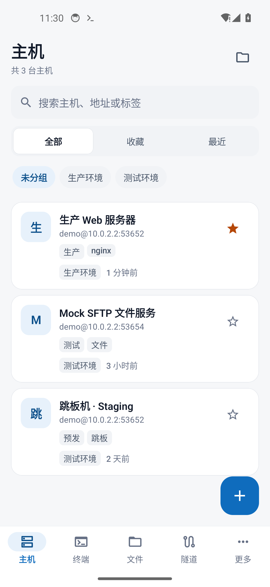
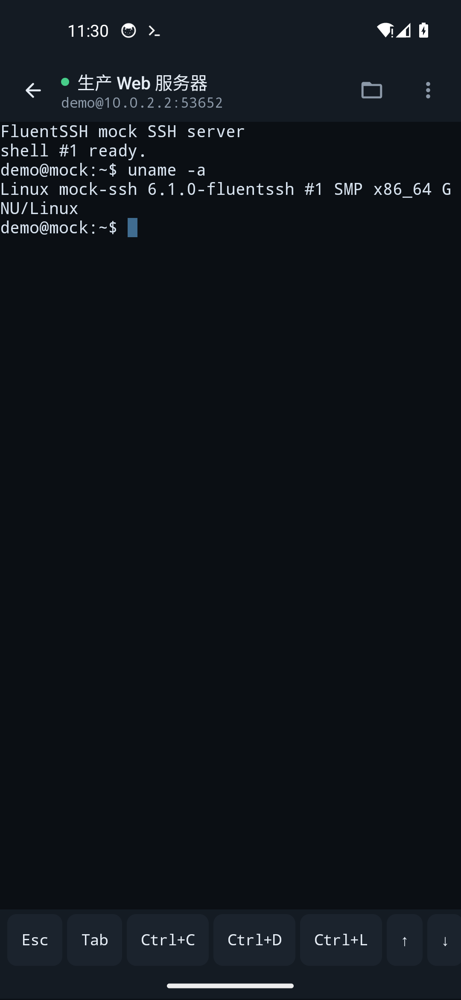
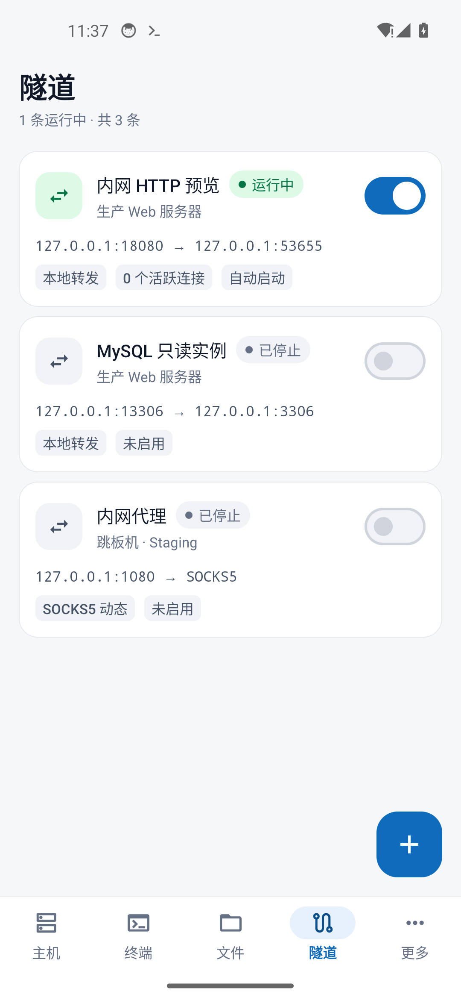

Android 版覆盖主机与分组、多会话终端、SFTP 文件、SSH 隧道、远程命令、密钥、Known Hosts、审计与会话录制，并通过 70/70 JVM 单测与 Android 14 模拟器端到端验证（[验证记录](android/docs/VERIFICATION.md)）。

> 下文“功能”章节描述 Windows 桌面版；Android 功能清单见 [`android/README.md`](android/README.md)。

---

## 功能

### 主机与认证
- 主机分组、收藏、标签、搜索与最近连接
- 密码、私钥、Keyboard-interactive 认证
- Windows DPAPI 凭据加密，按当前 Windows 用户隔离
- 首次连接主机密钥指纹确认；指纹变化显式告警；Known Hosts 可移除
- 导入 `~/.ssh/config` 子集（Host / HostName / User / Port / IdentityFile）
- 主机级启动命令、默认目录、保活开关与备注

### 原生终端
- 多标签原生终端，独立 SSH 会话
- XtermSharp ANSI 终端模拟，支持颜色、光标、备用屏和窗口尺寸调整
- 选择复制、粘贴、清屏、重连、关闭会话
- 可选的本地会话录制，输出写入 `%APPDATA%\FluentSSH\logs`
- 终端字号与字体可配置

### SFTP 文件管理
- 目录浏览、上级目录、路径跳转与刷新
- 上传、下载、进度显示
- 新建文件夹、重命名、删除（目录递归删除）
- 远程文本编辑与保存（UTF-8，单文件上限 4 MB）

### SSH 隧道
- 本地转发、远程转发与 SOCKS5 动态转发
- 启动 / 停止、编辑、删除，以及应用启动时自动开启
- 隧道运行状态与错误原因来自真实 SSH.NET 连接事件

### 命令与片段
- 对任意已保存主机执行一次性命令
- 输出、退出码与耗时统计
- 常用命令片段管理，双击填入
- 命令历史，保留主机与执行时间
- `Ctrl+Enter` 执行，并拦截中文输入法组字过程中的 Enter

### 安全与记录
- RSA 3072 密钥生成，生成 OpenSSH 公钥并可直接复制
- 私钥导入到应用数据目录
- Known Hosts 列表与信任移除
- 审计事件：连接、SFTP、隧道、命令、安全操作
- 会话录制文件打开与删除

### 桌面体验
- 浅色 / 深色 / 跟随系统主题
- 键盘导航：`Ctrl+1..7` 切换模块，`Ctrl+N` 新建主机，`Ctrl+,` 设置
- 所有凭据仅保存在本机；无遥测、无云同步
- 原生窗口最大 / 最小 / 关闭按钮与系统 DPI 缩放

## 设计规范

界面遵循 [`desktop-agent-ui`](https://github.com/Ludi-Herry/desktop-agent-ui) 的桌面视觉规则：

- 中性分层 Surface，不使用装饰性阴影与左边缘彩条
- 0.5px 发丝边框；嵌套容器使用同心圆角
- 全局字号收敛为 20 / 13 / 12 三档，正文不小于 12px
- 禁用中点分隔符，移除冗余副标题，让布局本身承担层级
- 原生窗口控制、原生滚动和 WPF 输入法语义
- 状态与真实事件对应：连接、隧道和命令状态不使用计时器伪造

## 下载

Windows 便携版：[GitHub Releases](https://github.com/lcyyun/FluentSSH/releases/latest)（自包含单文件，无需安装 .NET）。

## 构建与运行

环境要求：Windows 10/11 x64，.NET 10 SDK。

```powershell
# 直接运行（开发）
dotnet run --project native\FluentSSH\FluentSSH.csproj

# 构建 Release
dotnet build native\FluentSSH\FluentSSH.csproj -c Release

# 发布自包含单文件
dotnet publish native\FluentSSH\FluentSSH.csproj -c Release -r win-x64 --self-contained true `
  -p:PublishSingleFile=true -p:IncludeNativeLibrariesForSelfExtract=true `
  -p:EnableCompressionInSingleFile=true -p:DebugType=None `
  -o dist\FluentSSH-native-win-x64
```

也可以使用封装好的脚本：

```powershell
powershell -NoProfile -ExecutionPolicy Bypass -File scripts\native-publish.ps1
```

发布产物：

```text
dist\FluentSSH-native-win-x64\FluentSSH.exe      # 直接双击运行
dist\FluentSSH-native-win-x64.zip                # 便携压缩包
```

## 测试

SSH 核心、SFTP、隧道和密钥生成的本地集成测试（需要先启动 mock lab）：

```powershell
pnpm mock-lab            # 终端 A
pnpm test:native         # 终端 B
```

UI 截图回归可使用原生截图参数：

```powershell
dist\FluentSSH-native-win-x64\FluentSSH.exe --capture qa.png --page hosts --delay 800
```

## 数据目录

```text
%APPDATA%\FluentSSH\
├── store.json         # 主机、分组、隧道、片段、历史、审计、设置
├── secrets.json       # DPAPI 加密的密码与私钥口令
├── keys\              # 导入/生成的私钥与公钥
├── logs\              # 终端会话录制
├── exports\           # 导出的 SSH Config
└── app.log            # 仅本地诊断日志
```

删除该目录即可完全清除本地数据。密码和口令不能在其他 Windows 用户下解密。

## 项目结构

```text
native/FluentSSH/
├── App.xaml                  # 启动、主题、异常处理
├── MainWindow.xaml           # 原生外壳、侧栏与导航
├── Core/                     # 数据、SSH、SFTP 相关服务、密钥、隧道、终端会话
├── Dialogs/                  # 主机、隧道、片段、密钥提示、远程编辑器
├── Features/                 # 主机、终端、文件、隧道、命令、安全、日志、设置
├── Themes/                   # Light / Dark 设计令牌与控件样式
└── Assets/                   # 应用图标
```

## 已知边界

- 当前版本不包含 SSH Agent 转发与 ProxyJump（跳板机会在后续版本加入）
- 远程编辑按 UTF-8 文本处理，二进制文件请使用下载后本地编辑
- Windows 独占；未提供 macOS/Linux 版本

## 早期 Web 原型

仓库中保留了早期的 React + Fluent UI Web 原型（`web/`、`server/`），用于产品探索与视觉对照；正式交付为本目录下的原生 WPF 应用。原生应用不依赖 Node.js、浏览器或本地 Web 服务。

## License

MIT
