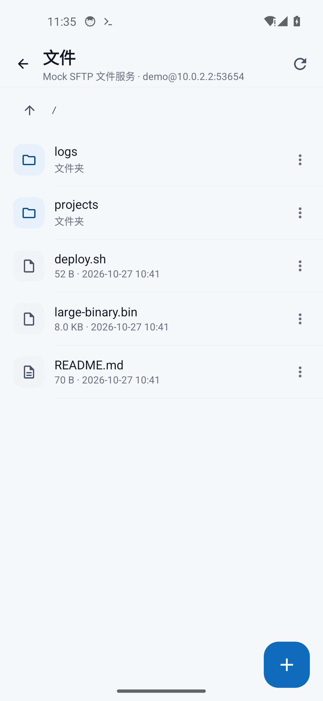
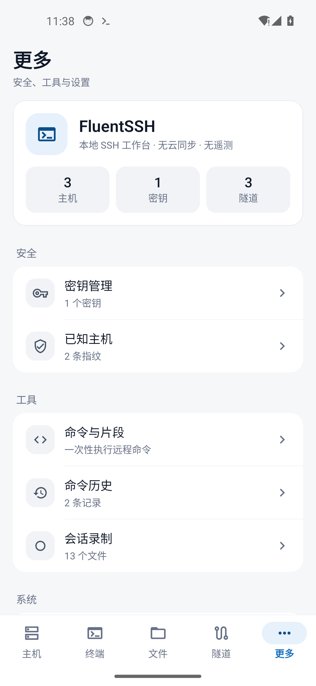
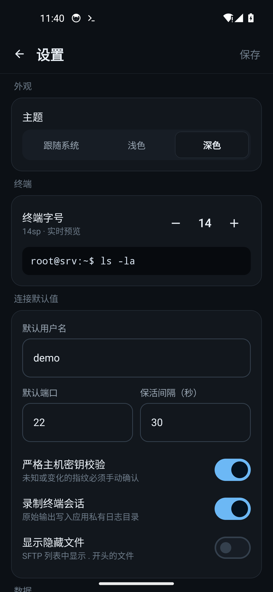

# FluentSSH for Android

真正原生的 Android SSH 工作台：**Kotlin + Jetpack Compose + Material 3**，不依赖 WebView、Electron 或任何浏览器内核。主机管理、交互终端、SFTP 文件、SSH 隧道、一次性命令、密钥与审计全部在设备本地完成。

- 终端内核：自研纯 Kotlin VT100/xterm 子集模拟器（ANSI 颜色、备用屏、滚动区域、UTF-8、宽字符、scrollback）
- SSH 引擎：JSch（mwiede 维护版）+ BouncyCastle Ed25519，密码 / 私钥 / Keyboard-interactive 认证
- 本地数据：Android Keystore AES-256-GCM 加密密码与私钥，应用私有目录 JSON 持久化，无云同步、无遥测
- 前台服务：会话与隧道在应用退到后台后保持运行，通知栏可回到应用
- 设计规范：严格遵循 [`mobile-design-system-skill`](https://github.com/Ludi-Herry/mobile-design-system-skill)，逐项走查见 [`docs/DESIGN-AUDIT.md`](docs/DESIGN-AUDIT.md)







完整截图：[`docs/screenshots/`](docs/screenshots)（Android 14 / Pixel 5 1080×2340 模拟器实机截取）。

---

## 功能

### 主机与认证
- 主机分组、收藏、标签、搜索、最近连接排序
- 密码、私钥、Keyboard-interactive 三种认证方式
- 首次连接主机密钥确认；指纹变化显式告警；Known Hosts 可移除
- Android Keystore 加密凭据，按应用私有目录隔离
- 导入 `~/.ssh/config` 子集（Host / HostName / User / Port）
- 主机级启动命令、默认目录、保活开关与备注

### 原生终端
- 多会话标签，独立 SSH PTY（xterm-256color）
- ANSI 16/256/真彩色、粗体/斜体/下划线/反色、备用屏、滚动区域
- 上滑查看 scrollback，点按回到底部
- 软键盘输入（中文输入法组字期间不误发）、硬件键盘与 Ctrl 组合键
- 扩展按键栏：Esc / Tab / Ctrl+C / Ctrl+D / Ctrl+L / 方向键 / Home / End / 管道符等
- 复制屏幕文本、粘贴、清屏、重连、断开
- 会话录制（原始输出写入应用私有 `logs/`）
- 可配置终端字号（10–22sp）

### SFTP 文件管理
- 目录浏览、上级目录、刷新、路径显示
- 上传（系统文件选择器）、下载（系统保存位置）、进度展示
- 新建文件夹、重命名、删除（目录递归删除）
- 远程文本编辑与保存（UTF-8，单文件上限 4 MB），未保存返回二次确认

### SSH 隧道
- 本地转发、远程转发、SOCKS5 动态转发
- 启动 / 停止 / 编辑 / 删除，应用启动时自动开启
- 运行状态、连接计数与错误原因

### 命令与片段
- 对任意主机执行一次性远程命令
- 输出、stderr、退出码与耗时统计
- 常用命令片段保存与一键填入
- 命令历史（主机、时间、退出码、输出）

### 安全与记录
- RSA 2048/3072/4096 密钥生成，OpenSSH 公钥可复制
- 私钥导入（OpenSSH / PEM）与口令支持
- Known Hosts 指纹列表与信任移除
- 审计事件：连接、SFTP、隧道、命令、安全操作
- 会话录制文件预览 / 删除

### 移动体验
- 浅色 / 深色 / 跟随系统
- 5 槽位底部导航（主机 / 终端 / 文件 / 隧道 / 更多），二级页面自动隐藏
- 底部抽屉按 30% / 60% / 80% 高度分档，表单抽屉禁止点遮罩关闭
- 状态栏 / 手势条安全区避让，软键盘防遮挡与输入框聚焦居中
- 所有可点区域 ≥ 48dp，最小字号 12sp，0.5dp 发丝边框，无装饰性阴影

---

## 设计规范落地

16 项移动端交付门禁的逐项实现与截图走查见 [`docs/DESIGN-AUDIT.md`](docs/DESIGN-AUDIT.md)。核心实现：

| 门禁 | 实现 |
| --- | --- |
| 安全区 | `statusBarsPadding()` / `navigationBarsPadding()` / `imePadding()` |
| 触控热区 | 所有图标按钮与列表行 ≥ 48dp |
| 键盘防遮挡 | `centerOnFocus()` 等待 IME 动画后 `bringIntoView()` |
| 底部抽屉 | `AppBottomSheet` 36×4dp 拖拽条 + 30/60/80% 分档 |
| 表单防误关 | 主机/隧道/密钥/认证抽屉 `dismissible=false` |
| 发丝边框 | `Hairline` / `BorderStroke(0.5.dp)` |
| 单一 CTA | 每个屏幕仅一个全宽主按钮或 FAB |
| 空态出口 | 每个列表空态均有说明与主行动按钮 |

视觉令牌集中在 [`app/src/main/java/com/fluentssh/mobile/ui/theme/Theme.kt`](app/src/main/java/com/fluentssh/mobile/ui/theme/Theme.kt)，组件在 [`ui/components/`](app/src/main/java/com/fluentssh/mobile/ui/components)。

---

## 架构

```text
com.fluentssh.mobile
├── data/          # 序列化模型、JSON 持久化、Keystore 加密
├── ssh/           # JSch 连接、认证回调桥、SFTP、端口转发、会话/隧道管理
├── terminal/      # 纯 Kotlin VT100/xterm 模拟器（可 JVM 单测）
├── service/       # 会话/隧道前台服务
├── core/          # AppContainer 手动依赖注入
└── ui/            # Compose 界面：主机 / 终端 / 文件 / 隧道 / 更多 / 设置 / 安全
```

- UI 依赖 `AppViewModel`，终端内核与 SSH 引擎均不依赖 Android UI。
- 终端会话与隧道运行在 `AppContainer` 单例中，Activity 重建不丢会话。
- 所有凭据使用 Android Keystore 中不可导出的 AES-256 key 加密后落盘。
- JSch 的 Ed25519 签名在 Android 上走 BouncyCastle 轻量实现（JCE 变体需要 Java 15+ API）。

---

## 构建

环境要求：JDK 17+、Android SDK Platform 34、Build-Tools 34.0.0。

```powershell
cd android

# Debug 包
./gradlew :app:assembleDebug
# 产物：app/build/outputs/apk/debug/app-debug.apk

# Release 包（当前使用 debug 签名，便于侧载；正式发布请替换 keystore）
./gradlew :app:assembleRelease
# 产物：app/build/outputs/apk/release/app-release.apk

# JVM 单元测试（终端内核 + SSH/SFTP/转发引擎，共 70 个用例）
./gradlew :app:testDebugUnitTest
```

Gradle Wrapper 使用腾讯云镜像下载 Gradle 8.6，国内网络更稳；如使用官方源可修改
`android/gradle/wrapper/gradle-wrapper.properties` 中的 `distributionUrl`。

`android/local.properties` 指向本机 Android SDK（该文件不入库）：

```properties
sdk.dir=C\:\\path\\to\\android-sdk
```

### 已构建产物

- GitHub Release（含 APK）：<https://github.com/lcyyun/FluentSSH/releases/tag/android-v1.0.0>
- 直接下载：[FluentSSH-android-v1.0.0.apk](https://github.com/lcyyun/FluentSSH/releases/download/android-v1.0.0/FluentSSH-android-v1.0.0.apk)（13.4 MB，minSdk 26 / targetSdk 34）
- 本地产物：`dist/android/FluentSSH-android-v1.0.0.apk`

---

## 验收

### JVM 单元测试：70/70 通过

```text
TerminalEmulatorTest   53 tests   0 failures   0 errors
SshEngineTest          12 tests   0 failures   0 errors
KeyServiceTest          5 tests   0 failures   0 errors
```

终端内核覆盖：ANSI/CSI/OSC/SGR、备用屏、滚动区域、UTF-8 分片、CJK 宽字符、scrollback、resize、DSR/DA 应答。
SSH 引擎覆盖：内嵌 Apache MINA SSHD 服务器上的密码/私钥/键盘交互认证、主机密钥确认与变化告警、exec 退出码与超时、SFTP 中文路径、本地转发、SOCKS5 IPv4/域名、远程转发、密钥生成与导入。

### Android 14 模拟器端到端验证（真实 UI）

- 主机 CRUD、分组、收藏、搜索、最近连接
- 主机密钥确认弹层（指纹核对）→ 信任 → 建立真实 SSH PTY
- 终端输出、`uname -a` 执行、多会话标签、扩展按键、软键盘显隐、重连
- SFTP 连接、目录浏览、上传/新建/重命名/删除流程
- 隧道自动启动；通过 SSH 本地转发访问 HTTP 服务并拿到真实响应
  ```json
  {"service":"fluent-ssh-tunnel-target","method":"GET","path":"/","localPort":53655}
  ```
- 远程命令执行：退出码 0，输出/耗时展示
- RSA 3072 密钥生成、Known Hosts、审计日志、会话录制、浅/深色主题
- Release 包安装启动正常，数据持久化与 Keystore 解密正常

截图见 [`docs/screenshots/`](docs/screenshots)。

## 已知边界

- 暂未实现 SSH Agent 转发与 ProxyJump 跳板机
- 终端模拟器覆盖 VT100/xterm 常用子集，不含 sixel / 图片协议
- 远程编辑器按 UTF-8 文本处理，二进制文件建议下载后编辑
- 仅支持 Android 8.0（API 26）及以上
- 不包含云同步、遥测与崩溃上报
- release 包当前使用 debug 签名，正式上架前需替换为自己的 keystore
